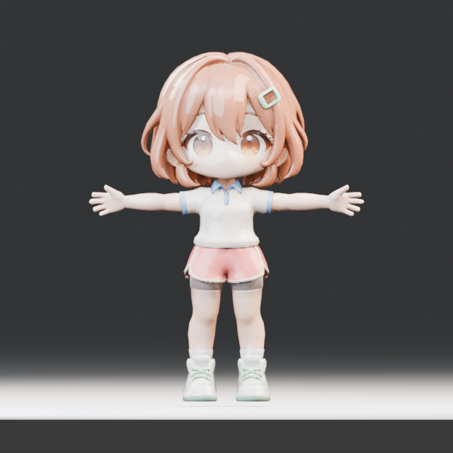

# Q版运动角色概念资产

角色参考图由 ImageGen 根据本项目的运动创作场景生成，再通过本机 `lixmal/tripo-mcp` 调用已认证的 Tripo CLI 生成并绑定模型。

## 文件

- `chibi-sports-avatar-reference.png` — 正面全身 T 字姿势的生成参考图。
- `chibi-sports-avatar-p1-walk.glb` — Tripo P1 模型，含双足骨架和 `walk` 动画。
- `chibi-sports-avatar-preview.png` — 从 GLB 离线渲染的正面绑定姿势预览。
- `public/models/chibi-sports-avatar.glb` — 工作台当前显示的角色模型副本。

P1 GLB 约 3.5 MB，包含 15,118 个顶点、11,710 个三角面、1 个蒙皮和 1 段动画，适合作为移动端模型方向的候选资产。

## 编辑器接入状态

工作台显示 Tripo 角色，并通过 `ChibiAvatarBridge` 将原始 `HumanRig` 的关节旋转映射到 Tripo 骨架。原来的文档坐标、IK 求解、画布拖拽和关节控制仍以项目骨架为准；关节点按可见角色位置显示，拖动位移再映射回原求解空间。

导出的 GLB 仍使用原骨架模型；工作台的 Q 版显示属于运行时视觉重定向。触屏设备上的 WebGL 与真实手势仍需在 CI 或其他开发机验证。

## 参考工作流

[Tripo 的角色工作流](https://www.tripo3d.ai/zh/blog/gpt-6-astra-3d-character-workflow)建议准备正面全身 T 字参考，检查手脚可见度与角色比例，然后测试肩、肘、头和膝部形变，再制作短动作。本次按该流程准备全身参考，完成 P1 建模、双足绑定和 walk 重定向。
